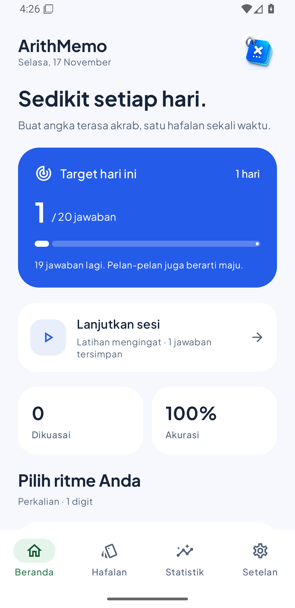
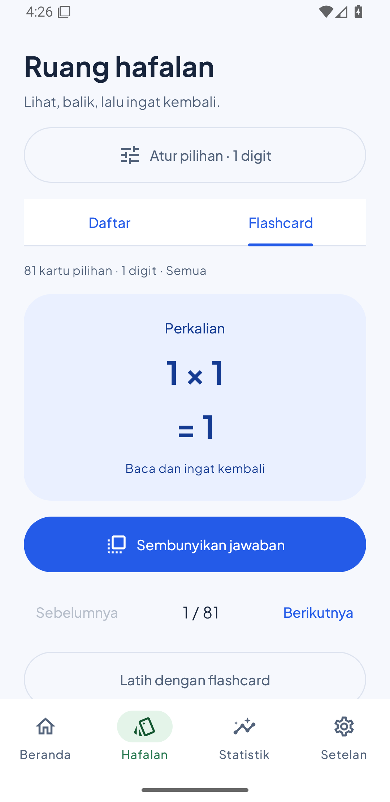
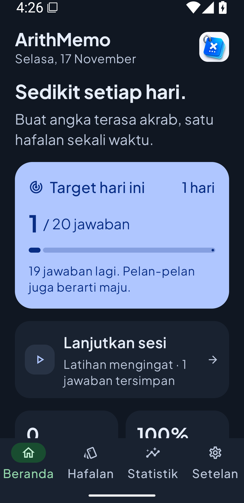

# ArithMemo

Hafalan aritmatika pribadi, sedikit setiap hari. Aplikasi Android native Kotlin + Jetpack Compose, tanpa akun, iklan, analitik, atau materi rumus. Semua aktivitas belajar berjalan offline.

<p>  </p>

## Memakai aplikasi

1. Pasang `ArithMemo.apk` dari [GitHub Release ArithMemo](https://github.com/WynnDev-rill/Wynn-Store/releases/tag/arithmemo-v1.0.0). Android 8.0 atau lebih baru.
2. Buka **Hafalan** atau **Setelan** untuk memilih operasi, operand 1–3 digit, dan kelompok. Minimal satu operasi harus aktif. Pengurangan tidak negatif; pembagian selalu bulat tanpa sisa.
3. Baca **Daftar**, buka jawaban pada **Flashcard**, atau mulai **Latihan mengingat**. Daftar/pratinjau tidak mengubah statistik.
4. **Ulangi terjadwal** mendahulukan kartu jatuh tempo lalu kartu baru. Salah/“Ulangi” dijadwalkan sekitar 1 menit; jawaban berhasil memperpanjang interval. **Tes kecepatan** berlangsung 60 detik aktif; meninggalkan layar menjeda waktu. **Soal acak** mengambil dari seluruh rentang operand yang dipilih.
5. Atur target harian dan pantau akurasi, penguasaan, waktu jawaban benar, hari beruntun, serta riwayat 7 hari. Flashcard memakai penilaian diri; waktunya tidak dicampur dengan kecepatan jawaban ketik.
6. Jawaban langsung disimpan melalui transaksi SQLite. Sesi yang terhenti dapat dilanjutkan setelah aplikasi ditutup. Ekspor cadangan JSON melalui **Setelan**, dan simpan file secara aman. Pemulihan meminta konfirmasi dan memvalidasi isi sebelum mengganti data. Menghapus aplikasi juga menghapus data lokalnya.

Katalog 1 digit mencakup semua pasangan valid. Untuk 2–3 digit, daftar berisi hingga 240 kartu pilihan stabil per operasi agar mudah dipelajari; mode acak mencakup seluruh rentang. Kelompok awal/akhir membagi rentang angka pertama menjadi dua. Semua statistik berasal dari jawaban nyata, tanpa data contoh.

## Pembaruan

Pemeriksaan foreground dan WorkManager sekitar sehari sekali, ketika internet tersedia. Notifikasi Android 13+ memerlukan izin opsional di Pengaturan. APK diunduh dari GitHub Releases dan diperiksa ukuran, SHA-256, identitas paket, versionCode dan sertifikat yang sama dengan aplikasi terpasang. Instalasi selalu melalui pemasang Android setelah Anda mengetuk **Pasang update**. Data belajar tidak dikirim ke GitHub.

## Pengembangan

JDK 21, Android SDK platform 36/build-tools 36.0.0, Gradle wrapper 8.13. Buat `local.properties` berisi `sdk.dir=/lokasi/android-sdk` (jangan commit).

```sh
./gradlew testDebugUnitTest lintRelease assembleDebug assembleDebugAndroidTest
adb devices
bash qa/run-device.sh
```

Build rilis bertanda tangan menggunakan keystore produksi yang sama untuk setiap versi. Baca [rilis dan pemulihan signing](docs/RELEASE.md). Workflow [verifikasi](../.github/workflows/arithmemo-android.yml) dan [rilis](../.github/workflows/arithmemo-release.yml) terpisah; rilis menunggu pemeriksaan perangkat API 26 dan 36.

- [Arsitektur](docs/ARCHITECTURE.md) dan [keputusan implementasi](docs/IMPLEMENTATION.md)
- [Riset dan sumber desain](docs/RESEARCH.md), [sistem desain](DESIGN.md)
- [Bukti pengujian dan batasan](docs/VERIFICATION.md)
- [Pedoman AI dan skill permanen](AGENTS.md)
- [Knowledge graph](graphify-out/GRAPH_REPORT.md)
- [Catatan rilis](docs/CHANGELOG.md), [lisensi pihak ketiga](THIRD_PARTY_NOTICES.md)

Instal Graphify dengan `uv tool install graphifyy==0.9.111`, lalu `bash tools/refresh-graph.sh`. Query graph sebelum penelusuran lintas modul. AST diproses lokal tanpa API key; graph bukan pengganti tes. Skill Ponytail Full, UI UX Pro Max, dan Impeccable sudah disimpan di `.agents/skills/`, dengan sumber/commit tercatat di `tools/SOURCES.json`. Instruksi pengguna dan desain yang diberikan selalu diutamakan.
