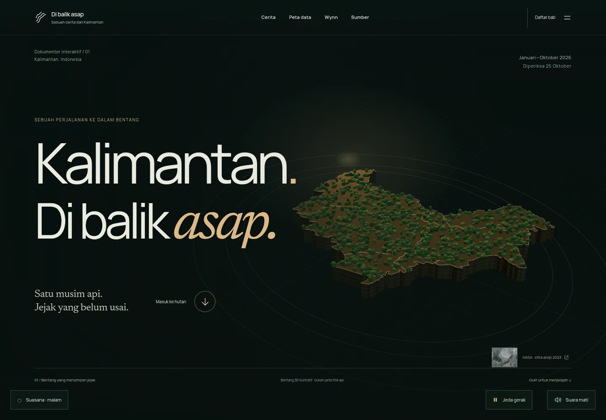
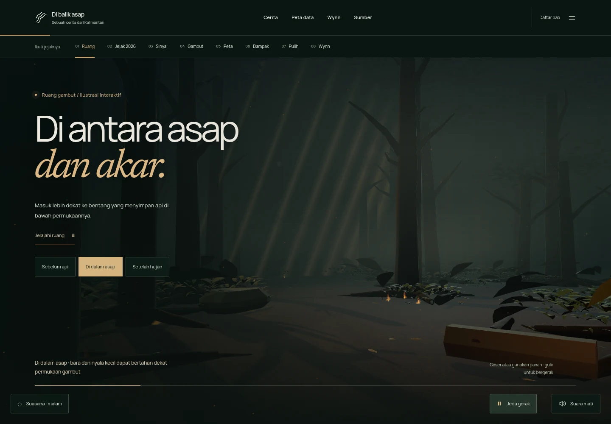
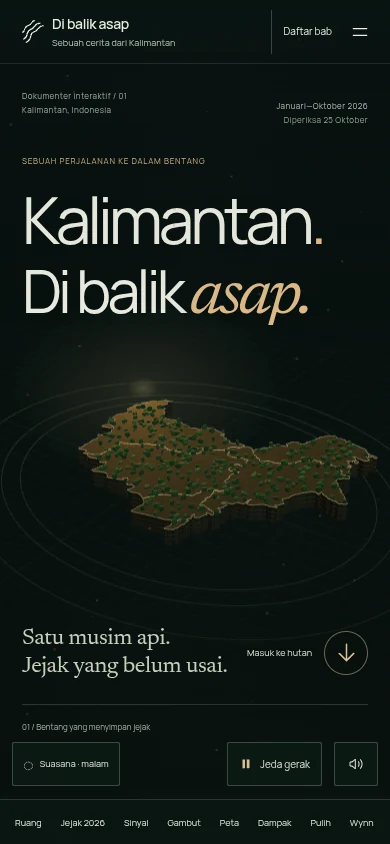
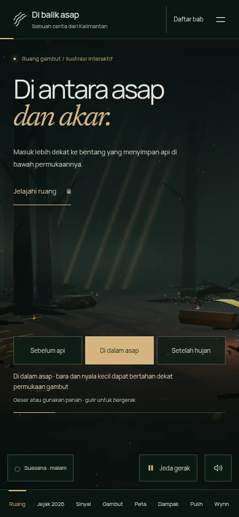

# Cinematic edition verification

Release: 27 October 2026. Scope: `karhutla-kalimantan/` and its scoped CI workflow. Acceptance brief: [CINEMATIC-DESIGN.md](CINEMATIC-DESIGN.md); research: [CINEMATIC-REFERENCE-RESEARCH.md](CINEMATIC-REFERENCE-RESEARCH.md).

## Verification method

Use the built static output under the actual production Content-Security-Policy. Inspect browser screenshots as well as state assertions. The new cinematic suite checks visible compositor pixels for paused canvases instead of relying on a cleared WebGL drawing buffer, and also requires exact frozen camera state. Software-compositor captures showed only 1–2 level color quantization differences (maximum 2/255, no changed geometry); the test allows at most 3/255 per channel and requires zero pixels exceeding that tolerance. It records the measured difference rather than accepting arbitrary screenshot changes. Context-loss tests use the real `WEBGL_lose_context` extension and verify both fallback and recovery. Texture-failure tests abort requests and require the complete procedural environment to remain usable. Fresh mobile browser contexts exercise the mobile renderer initialization path, not only resized desktop CSS.

All browser evidence is local Chromium with software WebGL and viewport/touch emulation. This is not physical-phone profiling, a real-user performance percentile or proof of deployment. The supplied reference video was sampled for composition; no exact animation/photorealism equivalence is claimed.

## Findings addressed during development

- The old weather edition switched dark forest scenes to bright reading surfaces. The cinematic edition uses a coherent dark baseline with warm accents; manual atmosphere choices remain available.
- Camera, atmospheric layers and vegetation lacked coordinated depth. The opening now reuses geographic outlines, the forest uses layered vegetation/photo materials, and both use bounded spline travel with damping.
- A review found blanket `document.getAnimations().play()` could restart completed word reveals and leave partial words clipped on pause. The controller now finishes entrance reveals, preserves readable headings and leaves ambient effects under the explicit pause contract.
- The weather regression now scrolls to an explicit chapter reading point and waits for the observed atmosphere state; a partially visible section and a fixed 250ms delay were not a reliable definition of chapter entry. Camera reversal tests likewise wait until the forward path crosses the entry plane before asking it to return, so in-flight damping is not mistaken for a failed reverse.
- The old avatar regression asserted a lazy image immediately after a smooth-scroll navigation. It now waits for the actual image load; it still fails if the asset never loads.
- The earlier browser screenshot batch exhausted its 30-second screenshot timeout under concurrent software-GPU suites. Runs are serialized; static documentation screenshots pause ambient motion after the separate live camera/control assertions. The screenshot timeout is 60 seconds. This is a test-environment constraint, not a measured hardware performance result.
- Weather disclosure styling now matches the cinematic surface; the accessibility suite audits the expanded panel in each mode.
- A specialist's earlier cross-scenario run captured an unlocated Three.js curve exception. The current camera look-ahead is clamped; the consolidated suite records full browser stacks and treats unexpected browser errors as failures. Final outcome is recorded below.

## Final command results

| Command | Observed result |
| --- | --- |
| `npm ci` | Succeeded with existing lockfile; no new dependency. |
| `npm test` | 4/4 data, transcription, CSV and citation tests passed. |
| `npm run build` | 40 source files checked; 0 errors/warnings in Astro check; 3 static routes; CSP scripts/local-link audit passed. Vite retains the documented shared-engine size warning. |
| `npm run test:browser` | 17/17 checks passed; zero unexpected page errors; zero axe violations across 9 page/chapter states. Includes 25 year/province selections, snapshot values, CSV, four peat states, menu/touch, no-JS and a throttled load sample. |
| `npm run test:weather` | 9/9 checks passed: manual modes, audio on/off, motion switch, manual pinning, automatic reading-point changes, mobile captures and reduced motion. |
| `npm run test:accessibility` | Zero WCAG A/AA findings in day/night/rain with the disclosure open, and on `/sumber/`. |

`npm run test:cinematic`: **17/17 passed, zero unexpected browser errors** on the final build. Actual camera movement in both directions, three visible forest states, compositor/camera pause, in-flight/early text readability, real WebGL context loss/restoration, reduced motion, no-JS, failed textures, direct map entry, sources and 404 were verified. Fresh 1440×1000, 390×844 and 320×740 contexts passed horizontal layout and caption/control non-overlap assertions. The earlier unlocated curve exception did not recur. Raw reports and logs are generated under ignored `test-results/`; CI uploads them for review. Checks were repeated according to the changed behavior: camera/failure regressions after renderer work, chapter layouts after clearance fixes, and static asset validation after replacing the archive thumbnail preload.

## Runtime budget and limits

The small archive reference now reuses the existing 50 KB thumbnail and is lazy-loaded; the full 331 KB archive image is no longer preloaded for a 62px reference. No new npm dependency. The shared Three.js chunk is roughly 602 KB minified / 150 KB gzip; it is shared across independently loaded renderers. Two 512² photographic maps total 154,570 bytes, served locally. The build emits its existing >500 KB shared-engine warning; the warning is retained rather than hidden. Hero rendering progressively replaces a complete local SVG, and the forest/cutaway are loaded near their chapters. DPR, instance counts, visibility and reduced motion are bounded. Continuous motion is optional.

The opening is an illustrative geographical sculpture: no measured terrain elevation, current forest-cover claims or invented hotspot positions. The forest is authored illustration, not documentary footage. Actual maps, dates, caveats, source readings and CSVs remain the evidence layer. See the updated public `/sumber/` page and asset/license manifests.

## Inspected final screenshots

The last inspection confirmed the caption/navigation text clears the fixed controls on desktop and mobile, the forest shares the opening's typography/light palette, and both scenes remain framed on narrow screens. Still images do not prove frame rate; the separate directional camera and pause assertions cover motion behavior.

| Desktop opening | Desktop forest |
| --- | --- |
|  |  |

| Mobile opening | Mobile forest |
| --- | --- |
|  |  |

The code is prepared on a feature branch for review; this verification is local built-output evidence, not proof that the production website has been deployed.
