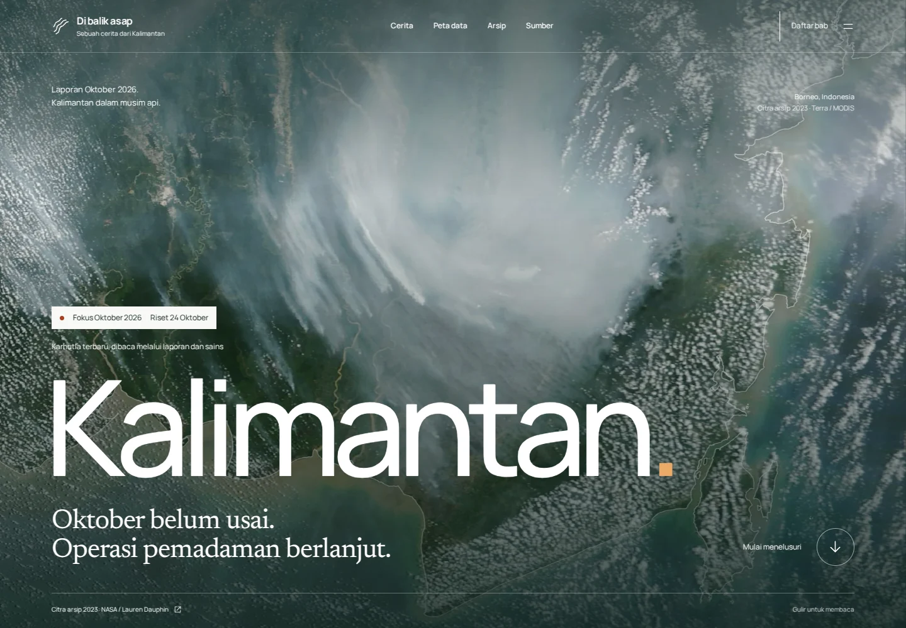
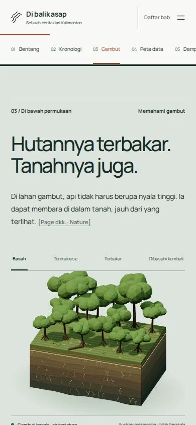

# Audit revisi — 24 Oktober 2026

Versi ini mengutamakan laporan karhutla Oktober 2026. Rincian perbandingan dengan OHZI, Minh Pham, The Pudding dan NASA terdapat pada [REVISION-2026.md](REVISION-2026.md); peninjauan sepuluh referensi ada di [DESIGN-REFERENCES.md](DESIGN-REFERENCES.md).

## Hasil yang dapat diulang

- **17 skenario browser lulus**, termasuk kedua snapshot terbaru, 25 kombinasi peta arsip, navigasi keyboard/touch, dialog dan pengembalian fokus, video NASA yang benar-benar diputar, empat kondisi gambut, perubahan kamera 3D, serta akses tanpa JavaScript.
- **4 tes data lulus**: presisi transkripsi KLHK, kelengkapan batas provinsi, kesamaan JSON/CSV historis, dan seluruh referensi sitasi.
- **Nol temuan otomatis axe** untuk WCAG 2 A/AA dan 2.1 AA pada beranda dan halaman sumber. Ini bukan sertifikasi aksesibilitas menyeluruh.
- **Nol error JavaScript** dalam pengujian desktop. Tidak ada overflow halaman pada lebar 320, 360, 390, 768, 1024, dan 1440 px.
- Build Astro, pemeriksaan tipe, tautan/aset lokal dan skrip dengan CSP ketat lulus. Peringatan ukuran bundle Three.js tetap ada; modul tersebut dimuat saat mendekati bab gambut.
- **LCP 1.180 ms; CLS 0,00316** pada satu pengukuran laboratorium Chromium 133, viewport 390×844, CPU diperlambat 4×, unduhan 200.000 byte/detik dan latensi 150 ms. Bukan pengukuran Android fisik atau data lapangan. Video dan Three.js tidak dimuat pada layar awal.

## Audit visual dan revisi

Screenshot desktop/mobile diperiksa setelah implementasi. Dibandingkan model awal di [gambut.webp](screenshots/gambut.webp), revisi memiliki variasi kanopi, akar, tekstur penampang, pemisahan lapisan dan framing kamera saat digulir. Bayangan lantai yang terlalu kasar diganti dengan kontak lembut; kontras header diperbaiki dengan menghilangkan transisi warna yang menghasilkan frame berkombinasi kontras rendah.

Komposisi hero, tipografi isi, keterbacaan model pada mobile, peta terbaru, serta pemisahan arsip telah diperiksa pada screenshot. Gerak menggunakan gulir alami, reduced motion tersedia, dan render 3D berhenti ketika tidak berubah atau berada di luar layar. Detail prosedural bersifat ilustratif, bukan rekonstruksi dokumenter atau aset fotorealistis setara produksi OHZI.

## Bukti visual

| Pembuka desktop | Model mobile |
|---|---|
|  |  |

- [Kamera dan penampang desktop](screenshots/revision-desktop-camera-depth.webp)
- [Peta cuplikan terbaru](screenshots/revision-desktop-peta-final.webp)
- [Laporan pembuka mobile](screenshots/revision-mobile-cerita-final.webp)

## Batas yang masih berlaku

Tidak ada klaim peringkat objektif di atas seluruh situs web. Standar rilis dinilai lewat fungsi, aksesibilitas otomatis, ketepatan sumber, performa terukur dan perbandingan visual berdasarkan dimensi tertentu. Perangkat fisik, penilai eksternal dan seluruh kombinasi teknologi bantu belum diuji. Cloud Browser menonaktifkan WebGL sehingga jalur 3D diperiksa dengan Chromium software rendering; fallback tetap tersedia.

Data terbaru memakai rilis Kemenhut sampai 24 Oktober dan snapshot SiPongi sampai 23 Oktober pukul 21.00 WIB, bukan feed langsung. Citra/foto/video tetap arsip bertanggal, tidak diberi label kejadian 2026. Hotspot adalah deteksi termal, bukan kejadian kebakaran atau luas terbakar.

Hasil mentah: [BROWSER-QA.json](BROWSER-QA.json), [PERFORMANCE-QA.json](PERFORMANCE-QA.json), [BUNDLE-SIZES.json](BUNDLE-SIZES.json). Jalankan `npm test`, `npm run build`, dan `npm run test:browser` untuk mengulang pemeriksaan; Playwright memerlukan Chromium yang tersedia.
