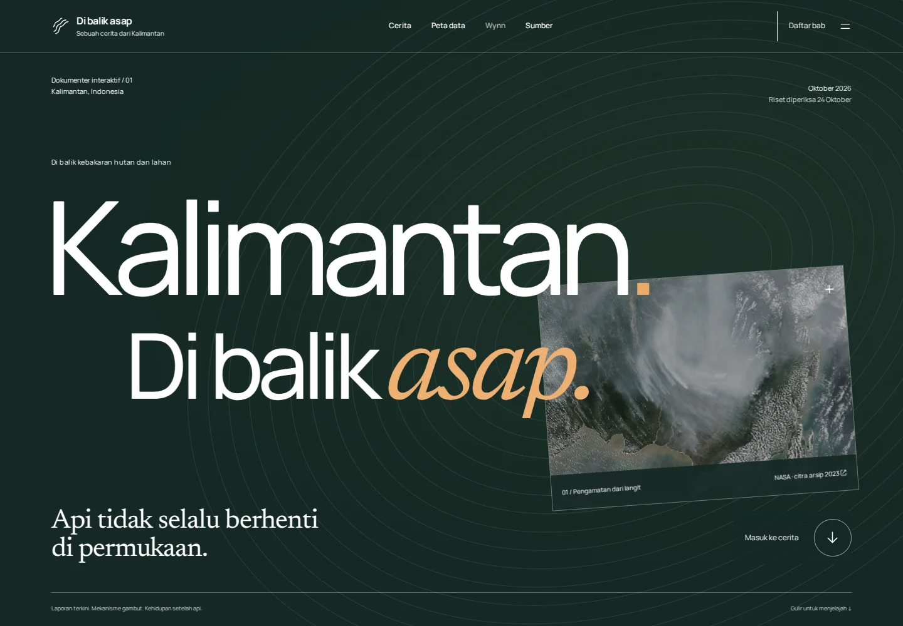
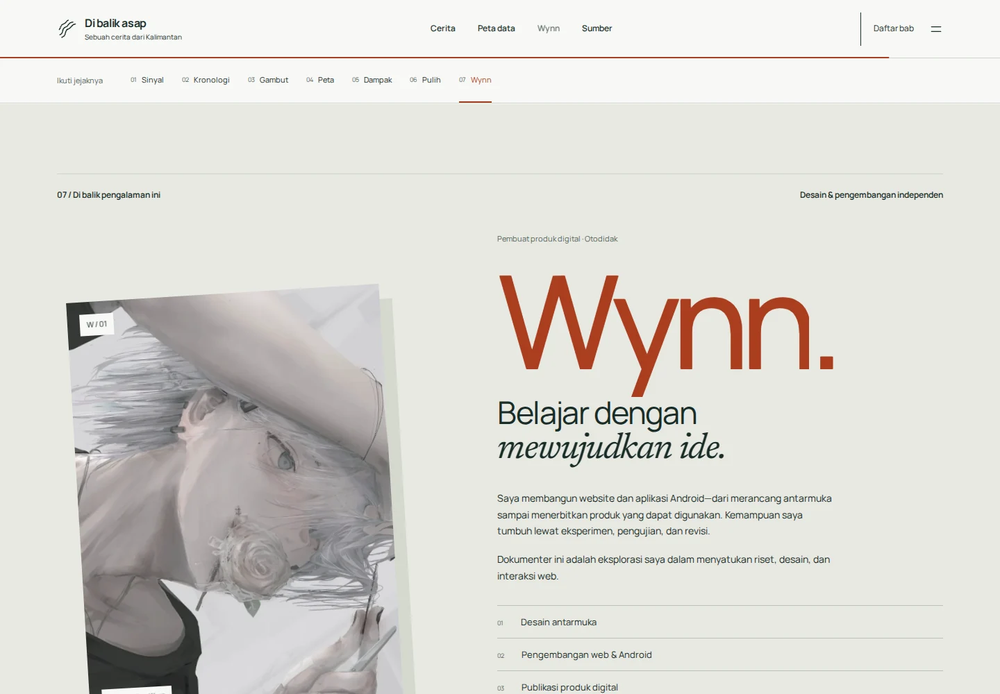

# Audit pengalaman visual — 24 Oktober 2026

Permintaan dan keputusan implementasi: [EXPERIENCE-REDESIGN.md](EXPERIENCE-REDESIGN.md). Fokus rilis ini adalah animasi di seluruh perjalanan, infografis ringkas dan profil Wynn sebagai pengganti galeri pengamatan.

## Hasil terukur

- **17 skenario browser lulus**: dokumen semantik, menu/fokus/Escape, tab kronologi, sembilan titik grafik, dua cuplikan hotspot, 25 pilihan peta arsip, keyboard pada peta, CSV/tabel, empat kondisi 3D, perubahan kamera, profil/avatar, motion teks dan kontur, sitasi, enam lebar viewport, touch/reduced motion, tanpa JS dan anggaran loading.
- **3 pemeriksaan tambahan lulus**: transform kontur benar-benar berubah saat scroll; WebGL sengaja dimatikan dan fallback SVG/tombol tetap berfungsi; reduced motion menjaga perspektif tetap dan tidak ada animasi berjalan.
- **4 tes data lulus**; build/TypeScript nol error, warning tipe atau hint; audit aset dan CSP ketat lulus. Peringatan ukuran chunk Three.js tetap ada, modul dimuat lazy.
- **Nol error JavaScript** dalam pengujian utama. **Nol temuan otomatis axe** pada sumber dan tujuh keadaan/bagian beranda. Ini bukan sertifikasi aksesibilitas menyeluruh.
- Viewport **320, 360, 390, 768, 1024 dan 1440 px**: tidak ada overflow horizontal halaman. Tabel tetap bisa digulir lokal. Emulasi sentuh dan reduced motion diuji.
- **LCP 1.508 ms; CLS 0,02948**, satu pengukuran lab Chromium 133, viewport 390×844, CPU 4× lambat, download 200.000 byte/detik dan latensi 150 ms. Server lokal tanpa kompresi, bukan Android fisik atau data lapangan. Three.js dan video tidak dimuat pada layar awal.

## Revisi berdasarkan pemeriksaan

| Temuan | Perbaikan | Bukti |
|---|---|---|
| Model lama memakai gumpalan kanopi faceted | Daun melengkung individual digabung per pohon, palet alami, framing diperiksa ulang | Screenshot mobile gambut dan empat kondisi tersimpan saat tes |
| Kredit citra dan tombol masuk bertumpuk di desktop | Lembar citra digeser naik, tombol memiliki ruang sendiri | Screenshot pembuka desktop |
| Kredit mobile terlalu kecil | Caption dinaikkan dan tautan diberi tinggi sentuh 44 px | Screenshot pembuka mobile |
| Galeri terasa seperti daftar sumber | Galeri/filter/dialog/pemutar dilepas; profil Wynn memakai avatar yang diberikan | Screenshot profil desktop/mobile; kredit media tetap di sumber |
| Tes kontur memeriksa sebelum smooth scroll selesai | Menunggu progres viewport yang nyata sebelum membandingkan transform | Tes tambahan membandingkan dua matriks CSS saat posisi scroll berubah |

## Perbandingan visual

Versi sebelumnya memakai pembuka citra layar penuh dan susunan editorial dominan. Revisi memakai judul kinetik, lembar citra berperspektif, alur sinyal, grafik waktu, bidang kontur berlapis, diorama organik, orbit partikel dan identitas pembuat. Referensi [OHZI dan sembilan situs lain](DESIGN-REFERENCES.md) diterapkan sebagai prinsip, tidak sebagai aset atau template.

| Pembuka baru | Profil Wynn |
|---|---|
|  |  |

- [Pembuka mobile](screenshots/experience-mobile-hero-final.webp)
- [Lapisan perspektif desktop](screenshots/experience-desktop-strata.webp) dan [mobile](screenshots/experience-mobile-strata.webp)
- [Gambut mobile](screenshots/experience-mobile-gambut-final.webp) dan [bara bawah tanah](screenshots/experience-peat-stage-2.webp)
- [Grafik mobile](screenshots/experience-mobile-riwayat-final.webp)

## Batas validasi

Tidak ada klaim persentase peningkatan objektif atau kesetaraan fotorealisme OHZI. Belum diuji pada perangkat Android fisik, semua pembaca layar, atau populasi penilai eksternal. Pemeriksaan real 3D menggunakan Chromium software rendering; Cloud Browser memiliki keterbatasan WebGL. Spline dipakai untuk studi scene, tetapi preview kosong sehingga tidak dimasukkan sebagai embed final. Blender/API generasi berbayar tidak dipakai.

Sumber terbaru tetap rilis Kemenhut hingga 24 Oktober 2026, cuplikan SiPongi hingga 23 Oktober 21.00 WIB. Citra 2023 dan foto 2021 ditandai sebagai arsip. Avatar adalah identitas ilustratif pilihan Wynn, bukan foto wajah. Klaim profil dibatasi pada karya web/Android serta proses desain dan publikasi.

Hasil mentah: [BROWSER-QA.json](BROWSER-QA.json), [EXPERIENCE-QA.json](EXPERIENCE-QA.json), [PERFORMANCE-QA.json](PERFORMANCE-QA.json), [BUNDLE-SIZES.json](BUNDLE-SIZES.json). Ulangi dengan `npm test`, `npm run build`, `npm run test:browser`, `npm run test:experience` (memerlukan Chromium; path kustom dapat diberikan melalui BROWSER_EXECUTABLE_PATH).
