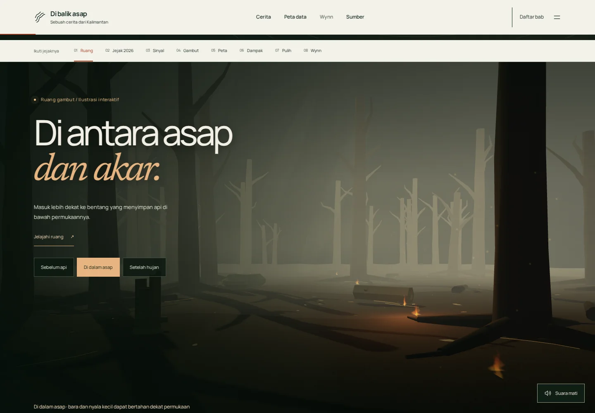
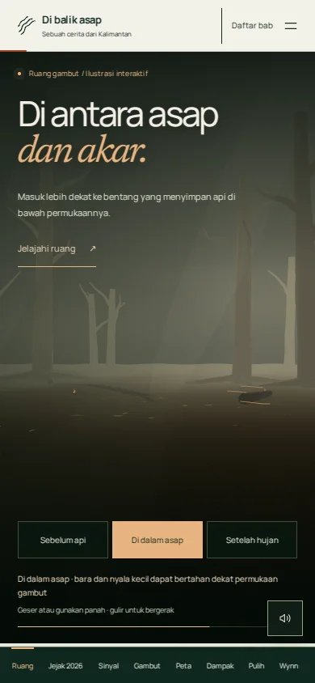
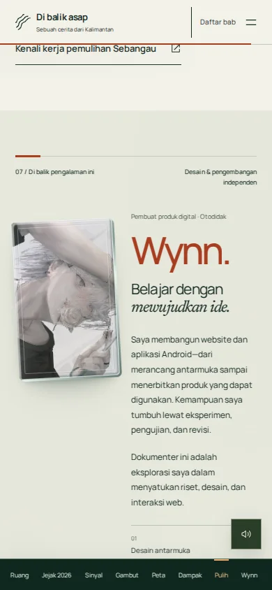

# Audit rilis — 25 Oktober 2026

## Hasil

- **17 skenario browser lulus**, termasuk kronologi, grafik, tiga snapshot terbaru, 25 kombinasi peta tahunan, navigasi keyboard/touch, empat kondisi 3D, kamera, profil, layout 320–1440 px dan isi tanpa JavaScript.
- **8 pemeriksaan pengalaman lulus**: kontur benar-benar berubah saat gulir, fallback WebGL, reduced motion, tilt keyboard/Escape dan orientasi sensor otomatis simulasi, tiga kondisi hutan/mode jelajah, audio start/stop, dan profil mobile berdampingan.
- **4 tes data lulus**. Build Astro/TypeScript dan audit aset/CSP lulus, nol error tipe/warning/hint; peringatan ukuran bundle 3D lazy tetap ada.
- **Nol error JavaScript** dalam suite utama; **nol temuan otomatis axe** pada sumber serta delapan keadaan/bagian beranda. Tidak berarti sertifikasi aksesibilitas lengkap.
- **LCP 2324 ms, CLS 0,08499** pada satu pengukuran lab Chromium133, viewport390×844, CPU4×, download200.000byte/detik, latensi150ms; bukan perangkat Android fisik. Hero 3D dimuat ketika terlihat; renderer gambut dan hutan tetap ditunda sampai babnya.

## Pemeriksaan visual dan pembanding

Lihat [IMMERSIVE-REVIEW.md](IMMERSIVE-REVIEW.md) dan [SEASON-DESIGN-REVIEW.md](SEASON-DESIGN-REVIEW.md) untuk pembandingan dengan prinsip OHZI, Minh Pham dan The Pudding, temuan serta perbaikan sebelum publikasi. Kronologi dan sumber kejadian: [SEASON-RESEARCH.md](SEASON-RESEARCH.md).

| Pembuka | Kartu Wynn tanpa teks overlay |
|---|---|
|  |  |

[Jejak musim mobile](screenshots/season-mobile-musim-final.webp) · [Jejak desktop](screenshots/season-desktop-musim-final.webp) · [Peta terbaru](screenshots/season-mobile-peta-final.webp)

## Batas

Tanggal awal Januari adalah catatan Kalimantan Barat, bukan satu tanggal penyalaan seluruh pulau. Timeline kurasi Januari–Oktober, pembaruan rilis terakhir yang diperiksa25Oktober, snapshot24Oktober21.00WIB. Bukan feed langsung. Foto/citra2021/2023 tetap diberi tanggal arsip.

Giroskop fisik belum diuji: browser menguji event simulasi otomatis, pointer/keyboard diperiksa langsung. Ketersediaan sensor bergantung perangkat, browser dan izin; kontrol sentuh tetap berfungsi. Gerak perangkat otomatis digunakan ketika browser mengizinkan data orientasi; tanpa tombol dan tanpa permintaan izin otomatis. Avatar tidak memuat badge, nama atau petunjuk di atas gambar.

Hasil mentah: [BROWSER-QA.json](BROWSER-QA.json), [EXPERIENCE-QA.json](EXPERIENCE-QA.json), [PERFORMANCE-QA.json](PERFORMANCE-QA.json). Ulangi dengan npm test, npm run build, npm run test:browser, npm run test:experience; Chromium diperlukan.

## Bukti edisi ruang

| Hutan mobile | Wynn berdampingan |
|---|---|
|  |  |

## Revisi lima adegan

17 skenario browser dan 11 pemeriksaan tambahan adegan/fallback lulus; 4 tes data lulus. Nol error JavaScript dan nol temuan otomatis axe di sembilan halaman/keadaan. Build TypeScript tanpa error/hint, peringatan bundle Three lazy tetap ada. Loading lab terbaru LCP2324ms/CLS0,08499, kondisi sama seperti di atas. Ini bukan pengujian HP fisik. Lihat [SPATIAL-REVIEW.md](SPATIAL-REVIEW.md) dan [SPATIAL-QA.json](SPATIAL-QA.json).
