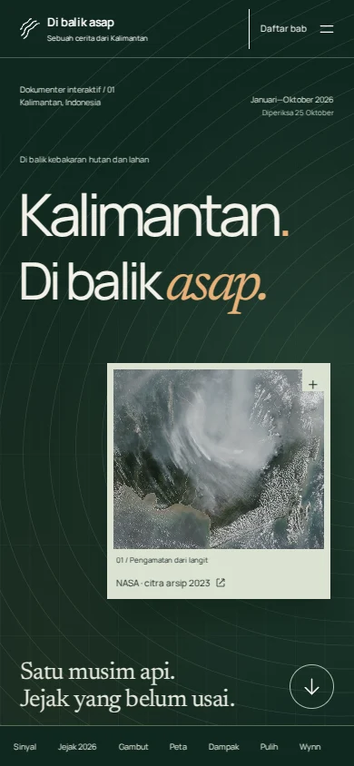
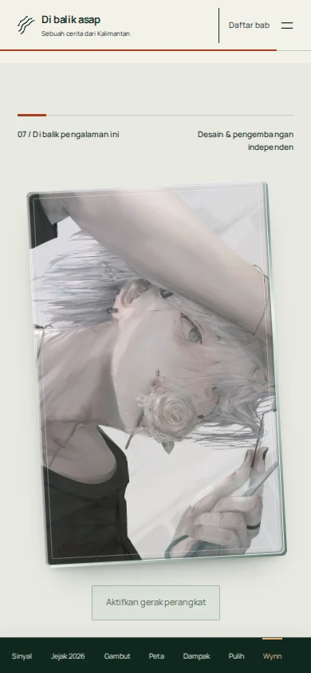

# Audit rilis — 25 Oktober 2026

## Hasil

- **17 skenario browser lulus**, termasuk kronologi, grafik, tiga snapshot terbaru, 25 kombinasi peta tahunan, navigasi keyboard/touch, empat kondisi 3D, kamera, profil, layout 320–1440 px dan isi tanpa JavaScript.
- **5 pemeriksaan pengalaman lulus**: kontur benar-benar berubah saat gulir, fallback WebGL, reduced motion, tilt keyboard/Escape dan jalur izin/orientasi sensor simulasi.
- **4 tes data lulus**. Build Astro/TypeScript dan audit aset/CSP lulus, nol error tipe/warning/hint; peringatan ukuran bundle 3D lazy tetap ada.
- **Nol error JavaScript** dalam suite utama; **nol temuan otomatis axe** pada sumber serta tujuh keadaan/bagian beranda. Tidak berarti sertifikasi aksesibilitas lengkap.
- **LCP 2.028 ms, CLS 0,01088** pada satu pengukuran lab Chromium133, viewport390×844, CPU4×, download200.000byte/detik, latensi150ms; bukan perangkat Android fisik. Three.js tidak dimuat di layar awal.

## Pemeriksaan visual dan pembanding

Lihat [SEASON-DESIGN-REVIEW.md](SEASON-DESIGN-REVIEW.md) untuk pembandingan dengan prinsip OHZI, Minh Pham dan The Pudding, temuan serta perbaikan sebelum publikasi. Kronologi dan sumber kejadian: [SEASON-RESEARCH.md](SEASON-RESEARCH.md).

| Pembuka | Kartu Wynn tanpa teks overlay |
|---|---|
|  |  |

[Jejak musim mobile](screenshots/season-mobile-musim-final.webp) · [Jejak desktop](screenshots/season-desktop-musim-final.webp) · [Peta terbaru](screenshots/season-mobile-peta-final.webp)

## Batas

Tanggal awal Januari adalah catatan Kalimantan Barat, bukan satu tanggal penyalaan seluruh pulau. Timeline kurasi Januari–Oktober, pembaruan rilis terakhir yang diperiksa25Oktober, snapshot24Oktober21.00WIB. Bukan feed langsung. Foto/citra2021/2023 tetap diberi tanggal arsip.

Giroskop fisik belum diuji: browser menguji event simulasi dan jalur izin, pointer/keyboard diperiksa langsung. Ketersediaan sensor bergantung perangkat, browser dan izin; kontrol sentuh tetap berfungsi. Gerak perangkat baru aktif setelah tombol ditekan. Avatar tidak memuat badge, nama atau petunjuk di atas gambar.

Hasil mentah: [BROWSER-QA.json](BROWSER-QA.json), [EXPERIENCE-QA.json](EXPERIENCE-QA.json), [PERFORMANCE-QA.json](PERFORMANCE-QA.json). Ulangi dengan npm test, npm run build, npm run test:browser, npm run test:experience; Chromium diperlukan.
