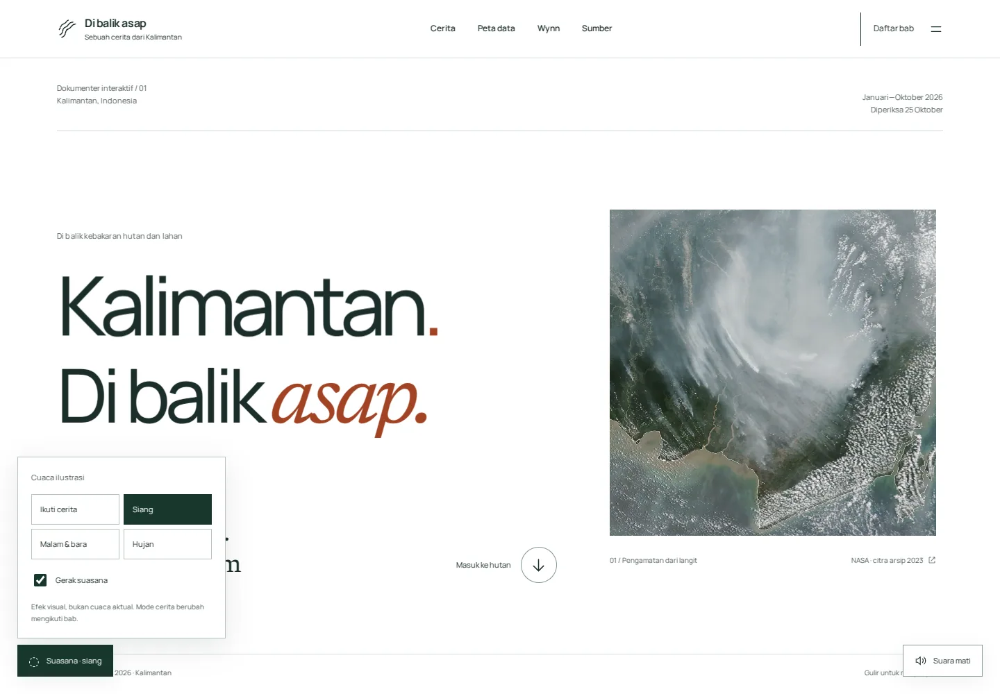
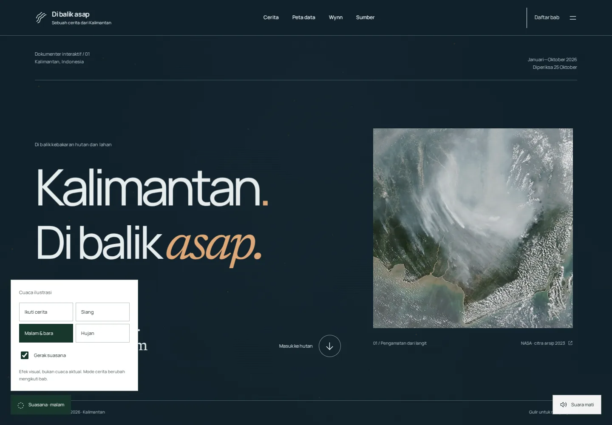

# Edisi suasana — 25 Oktober 2026

Revisi ini mengganti pendekatan pajangan model dengan satu atmosfer yang mengikuti cerita. Dasar siang putih biasa; malam mengubah seluruh permukaan menjadi biru gelap dengan tinta terang dan bara; hujan memberi garis air dan percikan pada viewport. Semua cuaca adalah ilustrasi, bukan laporan kondisi setempat atau rekonstruksi cuaca pada tanggal kejadian.

## Keputusan

- Lima panggung SpatialScene, satelit pajangan, peta ekstrusi, kumpulan partikel dalam kotak, dan lapisan tanah tambahan tidak lagi dirender di beranda.
- Transisi kontur terpisah dihapus. Hutan, diorama gambut dan kartu optik Wynn dipertahankan, dengan ruang baca, warna, dan navigasi diselaraskan.
- Satu canvas atmosfer2D transparan memenuhi viewport, tanpa menangkap klik. Asap tipis, bara dan hujan tidak berhenti pada batas kartu. Dua renderer3D yang dipertahankan tetap lazy dan pause di luar layar.
- Pilihan **Ikuti cerita / Siang / Malam & bara / Hujan** tersedia lewat disclosure native. Mode manual tetap terpilih ketika bergulir. Ikuti cerita mengembalikan perubahan otomatis.
- Cerita menggunakan siang pada pengantar, kronologi, sinyal dan peta; malam pada hutan dan dampak; hujan pada pemulihan; Wynn kembali siang. Pada gambut, suasana mengikuti keadaan ilustrasi: basah/terdrainase siang, terbakar malam, dibasahi kembali hujan. Ini pilihan dramaturgi, bukan fakta cuaca historis.
- Pencahayaan hutan mengikuti pilihan cuaca. Audio yang telah diaktifkan pengunjung menambah lapisan hujan pada mode hujan; crackle muncul pada malam. Tidak ada audio autoplay.
- Gerak suasana dapat dimatikan; reduced motion menampilkan ilustrasi statis. Saat tab tersembunyi, loop dihentikan. Mode siang berhenti merender setelah transisi atmosfer selesai.

## Aset dan sumber

Memanfaatkan aset KenneyCC0 yang telah tersedia di lingkungan hutan, citra dokumentasi NASA bertanggal dan foto Sebangau berlisensi sebagaimana kredit asli. Tidak menambah model yang berbeda gaya hanya untuk mengisi halaman. Hujan/kabut/bara dan audio sintetis dibuat dalam kode; tidak memerlukan API berbayar atau layanan cuaca. Tidak ada gambarAI dokumenter.

## Audit

Build/TypeScript dan4tes data dijalankan. Suite browser menguji navigasi,25kombinasi data tahunan,3cuplikan,model gambut,profil,layout320–1440px,isi tanpaJavaScript,aksesibilitas dan loading. WEATHER-QA.json mencatat9pemeriksaan cuaca:3mode manual,audio start/stop,pause,manual tetap terpilih,otomatis antar bab,screenshot mobile,dan reduced motion.

Screenshot siang/malam/hujan serta hutan,gambut,peta,pemulihan,Wynn diperiksa. Mode malam awal terlalu samar; direvisi menjadi seluruh lingkungan biru gelap. Dokumen SPATIAL-REVIEW.md adalah catatan versi sebelumnya, bukan rancangan aktif.

Kualitas OHZI tetap referensi arah, bukan klaim kesetaraan atau jaminan frame rate di perangkat fisik. Perubahan ini mengatasi ketidakselarasan panggung3D dan menyediakan satu suasana global yang dapat dimainkan. Benchmark perangkat fisik belum tersedia.

## Hasil rilis

17skenario browser,9pemeriksaan cuaca/audio dan4tes data lulus. Nol error JavaScript. Axe tidak menemukan pelanggaran otomatis pada9halaman/keadaan di suite utama, serta siang/malam/hujan dengan tabel historis dibuka dan halaman sumber. LCP2900ms, CLS0,00825 pada lab Chromium133 viewport390×844,CPU4×,download200000byte/detik,latensi150ms,server tanpa kompresi. Renderer3D tidak dimuat di layar awal. Hasil bukan pengukuran perangkat fisik.

